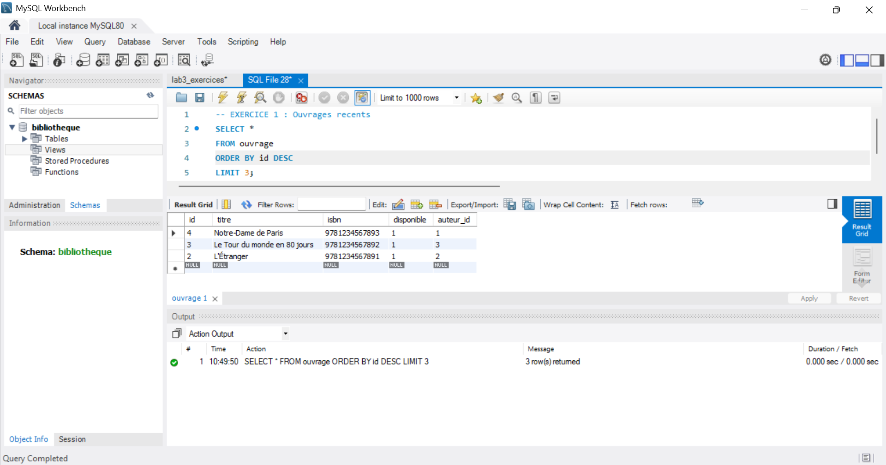
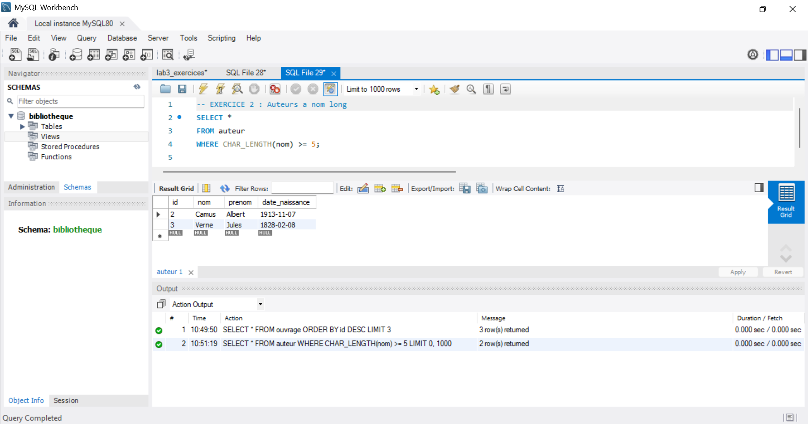
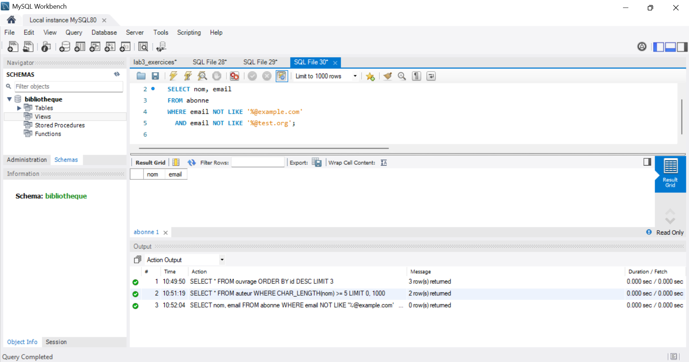
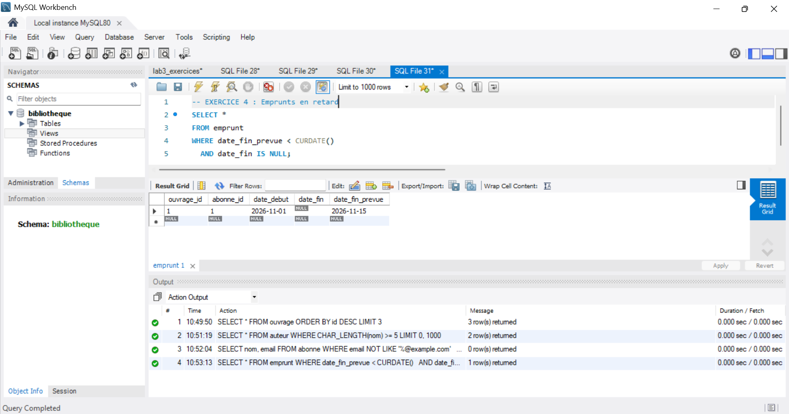
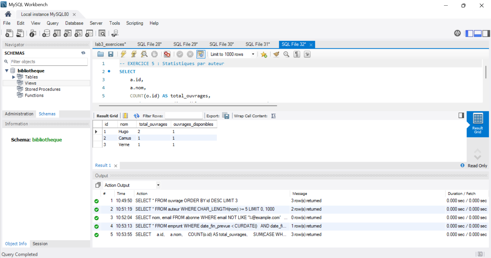

# MySQL Lab 3 – Requêtes SQL

## Description
Ce laboratoire permet de pratiquer les requêtes SQL avec la base de données `bibliotheque` créée dans le Lab 2.

## Exercices réalisés
- Exercice 1 : Ouvrages récents
- Exercice 2 : Auteurs à nom long
- Exercice 3 : Abonnés hors domaine
- Exercice 4 : Emprunts en retard
- Exercice 5 : Statistiques par auteur

## Structure du projet
- `sql/` : scripts SQL des exercices.
- `exports/` : résultats des requêtes au format CSV.
- `screenshots/` : captures d'écran des requêtes et résultats.

## Captures d'écran

### Exercice 1 – Ouvrages récents

### Exercice 2 – Auteurs à nom long

### Exercice 3 – Abonnés hors domaine

### Exercice 4 – Emprunts en retard

### Exercice 5 – Statistiques par auteur

## Export des résultats
Les résultats des cinq exercices ont été exportés au format CSV dans le dossier `exports/`.

## Outil utilisé
MySQL Workbench